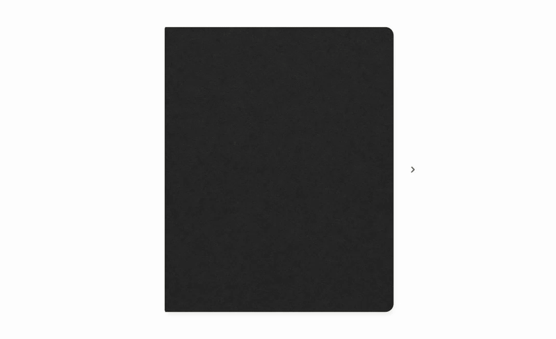
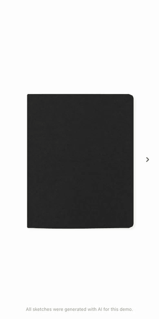

# Sketchbook

A quiet, interactive sketchbook built with React and Three.js, with desktop spreads and curled paper on mobile.

**[Open the live demo](https://niyamax.github.io/sketchbook/)**

## Previews

<table>
  <tr><th>Desktop</th><th>Mobile &amp; tablet</th></tr>
  <tr>
    <td valign="top"></td>
    <td valign="top"></td>
  </tr>
</table>

All sketches were generated with AI for this demo. The cover texture is AI-generated too.

## Features

- Two-page 3D desktop spreads with curved paper, hard covers, draggable corners and keyboard navigation.
- A folded-paper mobile reader with tap, swipe, hold and grouped rapid turns.
- An unprinted charcoal cover, 4:5 pages, rounded opening corners and subtle lighting.
- Reduced-motion support, accessible page announcements and a DOM fallback when WebGL is unavailable.

Both layouts share the same Three.js paper material, textures and lighting. The layout switches at 768 px. This is a frontend-only demo with no backend or persistent storage.

## Run locally

Requires **Node.js 22 or newer** and npm.

```sh
git clone https://github.com/niyamax/sketchbook.git
cd sketchbook
npm ci
npm run dev
```

Use `npm run dev -- --host 0.0.0.0` to preview on a phone on the same network.

```sh
npm run build
npm run preview
```

The production files are generated in `dist/`.

## Controls

Use the side chevrons or keyboard arrow keys. Desktop also supports dragging page corners. On mobile, tap or swipe to turn; rapid clicks and holding turn groups of pages. Focus the mobile book to use Enter, Space, Home and End.

## Customize

- **Artwork:** add images to `public/sketches/ink/` and edit the image paths and alt text in `src/sketch/sketches.ts`.
- **Pages:** edit `src/sketch/SketchPage.tsx` for the layout shared by both readers.
- **Cover:** replace `public/textures/charcoal-paper.png`.
- **Appearance:** adjust `src/styles/book.css` and `src/styles/sketchbook.css`.
- **Motion:** mobile timing lives in `src/components/mobile-book-motion.ts`; desktop settings are in `src/sketch/DesktopSketchbook.tsx`.

Update the disclosure in `src/sketch/Sketchbook.tsx` if you replace the demo artwork.

## Deployment

The included GitHub Actions workflow builds and deploys `main` to GitHub Pages. The Pages asset base is `/sketchbook/`; local development uses `/`.

```sh
GITHUB_PAGES=true npm run build
GITHUB_PAGES=true npm run preview
```

Open `/sketchbook/` on the preview server. For a fork, update the Pages base in `vite.config.ts` and enable GitHub Actions as the Pages source.

## License and credits

Code is licensed under [MIT](LICENSE). Dependencies retain their own licenses.

The navigation chevrons are from the **free Pikaicons Stroke set** by Ashish Kashyap: [Pikaicons](https://pikaicons.com/free-icons) · [icon license](https://pikaicons.com/license). These icons retain their own license and are not covered by this repository's MIT license.
