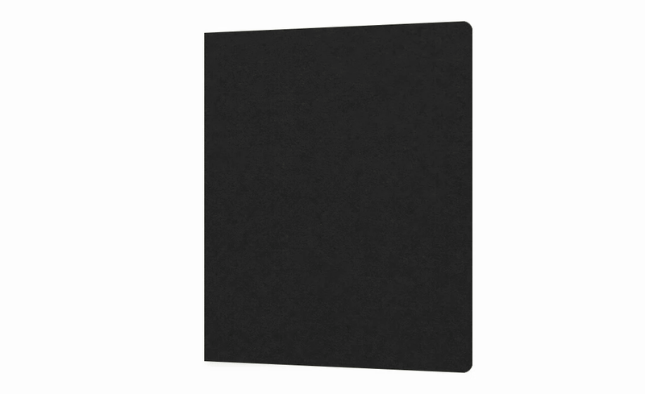

# Sketchbook

A quiet, interactive sketchbook for the web. Browse ink studies in a desktop spread or turn curled paper on your phone.

**[Open the live demo](https://niyamax.github.io/sketchbook/)** · [How the book works](docs/rendering-notes.md) · [Contributing](CONTRIBUTING.md)

## Previews

<table>
  <tr><th>Desktop</th><th>Mobile &amp; tablet</th></tr>
  <tr>
    <td valign="top"></td>
    <td valign="top"></td>
  </tr>
</table>

Still previews: [desktop](docs/previews/desktop.webp) · [mobile](docs/previews/mobile.webp). These are recordings of the app itself.

All sketches were generated with AI for this demo. The cover texture is AI-generated too; reference photographs are not included.

## The experience

- **Desktop:** two-page spreads, hard covers, corner dragging, side chevrons and keyboard navigation.
- **Mobile and tablet:** a single readable page with a curled paper fold, tap and swipe navigation, hold-to-repeat and grouped rapid turns.
- **A tactile finish:** 4:5 pages, an unprinted charcoal cover, rounded opening corners, paper grain and restrained lighting.
- **Quiet controls:** unavailable arrows stay hidden. During cover motion, the controls hide immediately and return with a short fade after it settles.
- **Accessible fallbacks:** page announcements, keyboard controls, reduced-motion support and a DOM reader when WebGL is unavailable.

The layout switches at 768 px. This is a frontend-only demo: no account, backend, analytics, submission form or persistent storage is required.

## Run locally

Use **Node.js 22 LTS** and npm. The included `.nvmrc` selects Node 22.

```sh
git clone https://github.com/niyamax/sketchbook.git
cd sketchbook
npm ci
npm run dev
```

Open the local URL printed by Vite. To preview on a phone connected to the same network:

```sh
npm run dev -- --host 0.0.0.0
```

### Checks and production preview

```sh
npm test
npm run build
npm run preview
```

The production files are written to `dist/`. A modern browser with WebGL 2 is recommended for the mobile paper renderer; reduced motion and unavailable WebGL use the DOM reader.

## Controls

| Action | Desktop | Mobile & tablet |
| --- | --- | --- |
| Turn a page | Side chevrons or page corners | Side chevrons, tap or swipe |
| Turn several pages | Repeat the navigation action | Click rapidly or hold to turn a packet |
| Keyboard | Left and right arrow keys | Focus the book, then use arrow keys, Enter or Space |
| Jump to first / last page | — | Home / End while the book is focused |

The mobile cover turns separately from a packet of paper. Each paper leaf keeps a small, stable duration variation in both directions.

## Make it your own

**Artwork.** Add your images to `public/sketches/ink/`, then edit `src/sketch/sketches.ts`. Each item has a root-relative `src` and descriptive `alt` text. Transparent PNGs work well with the paper texture. The current artwork uses a 4:5 canvas.

**Page layout.** Edit `src/sketch/SketchPage.tsx` to change how each illustration sits on a page. Its DOM content also supplies the mobile sheet texture.

**Cover and colors.** Replace `public/textures/charcoal-paper.png` or adjust the shared colors in `src/styles/book.css` and the reader styles in `src/styles/sketchbook.css`.

**Motion.** Mobile duration and packet settings live in `src/components/mobile-book-motion.ts`. The desktop controller lives in `src/sketch/DesktopSketchbook.tsx`. See the [rendering notes](docs/rendering-notes.md) before changing fold geometry or lighting.

If you replace the demo sketches with your own artwork, update the disclosure in `src/sketch/Sketchbook.tsx` and include the appropriate credits.

## Project structure

```text
src/
  sketch/                   Page catalog, layouts, desktop reader and lighting
  components/
    BookCover.tsx           Shared cover
    MobileFoldedBook.tsx    Mobile input and turn state
    mobile-book-motion.ts   Stable timing and grouped-turn rules
    mobile-paper-renderer.ts
  styles/                   Shared book and responsive reader styles
public/
  sketches/ink/             The 12 demo illustrations
  textures/                 Charcoal cover texture
tests/                      Pose, shadow-state and turn-rule checks
docs/                       Previews, artwork provenance and rendering notes
```

Built with React, TypeScript, Vite, Three.js, Motion and react-pageflip. The mobile fold is a deformed paper mesh; desktop page geometry comes from PageFlip. Ground shadows are CSS, and mobile shadow maps are disabled.

## Deployment

GitHub Actions checks changes and publishes `main` to [GitHub Pages](https://niyamax.github.io/sketchbook/). The Pages build uses `/sketchbook/` as its asset base; local development uses `/`.

To inspect that build locally:

```sh
GITHUB_PAGES=true npm run build
GITHUB_PAGES=true npm run preview
```

Open `/sketchbook/` on the preview server. For a fork, change the Pages base in `vite.config.ts` to match your repository name and enable **GitHub Actions** as the Pages source.

The [earlier demo URL](https://niyamax.github.io/sketchbook-demo/) remains available for existing links.

## Credits and license

Code is licensed under [MIT](LICENSE). The navigation chevrons are from the free Pikaicons Stroke set by Ashish Kashyap and retain their own license. See [third-party notices](THIRD_PARTY_NOTICES.md), [illustration prompts](docs/ink-sketch-prompts.json) and [cover material notes](docs/cover-material.md).
